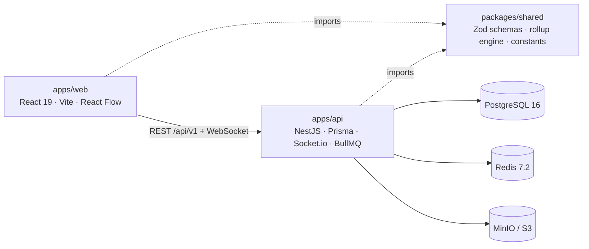

# FlowTrack — Project Documentation

**Version:** 0.3.0  
**Project type:** Visual workflow and project-governance platform  
**Repository:** `Project-managment-app/`

FlowTrack combines a visual, node-based workflow canvas with project-management controls such as role-based permissions, approval gates, auditable deadline extensions, calculated progress, document management, and executive reporting.

> This document is based on the supplied project overview. Details not specified there—such as exact API routes, complete database fields, deployment topology, and production secrets—should be confirmed in the relevant source files and the documents under `docs/`.

## Contents

- [1. Product Overview](#1-product-overview)
- [2. Core Concepts](#2-core-concepts)
- [3. Features](#3-features)
- [4. Architecture](#4-architecture)
- [5. Technology Stack](#5-technology-stack)
- [6. Repository Structure](#6-repository-structure)
- [7. Local Development Setup](#7-local-development-setup)
- [8. Environment Configuration](#8-environment-configuration)
- [9. Roles and Permissions](#9-roles-and-permissions)
- [10. Progress Calculation Rules](#10-progress-calculation-rules)
- [11. Typical User Workflow](#11-typical-user-workflow)
- [12. Scripts Reference](#12-scripts-reference)
- [13. Testing and CI](#13-testing-and-ci)
- [14. Internationalisation](#14-internationalisation)
- [15. Security Notes](#15-security-notes)
- [16. Further Documentation](#16-further-documentation)
- [17. Contribution Notes](#17-contribution-notes)

## 1. Product Overview

Many projects have dependencies, approval steps, parallel workstreams, and nested task structures. A conventional checklist can make these relationships difficult to see, while a diagramming canvas alone does not provide enough persistence or accountability.

FlowTrack brings these needs together:

- A visual canvas represents work as connected task nodes.
- Nested canvases organise work into stages, groups, and child tasks.
- Shared domain logic calculates progress and validates workflow rules.
- Role-based access controls determine who can perform sensitive actions.
- Audit records capture changes and support accountability.
- Reporting provides project-level KPIs and exportable task data.

The product is intended for project environments such as software, construction, manufacturing, and cross-functional programmes.

## 2. Core Concepts

### 2.1 Canvas and nodes

Tasks are represented as nodes on an interactive canvas. Directed connections express relationships and workflow sequence. Stage or Group nodes can contain a separate sub-canvas for more detailed planning.

### 2.2 Hierarchy

A project can be decomposed into nested stages and child tasks. Breadcrumb navigation shows the current position in the hierarchy, for example:

`Root › Phase 1 › Database Setup`

### 2.3 Task dossier

A task dossier brings together task remarks, status, assignments, documents, approval activity, custom fields, and audit history.

### 2.4 Governance

Certain actions are governed rather than silently accepted. For example, a deadline extension requires a reason and is logged; manager approval and confidential-document controls are also part of the workflow.

### 2.5 Progress rollups

Progress is calculated from child tasks and their weights. Parent completion and warning states are affected by child status and due dates.

## 3. Features

### Canvas Studio

- Connection handles on the top, bottom, left, and right of nodes.
- Floating node toolbar: Inspect, Add Next Step, Duplicate, Sub-Canvas, and Delete.
- A midpoint `+` control on sequence edges to insert a task between connected nodes.
- Dagre-based layouts:
  - **Tidy Flow:** left to right.
  - **Tree:** top to bottom.
- MiniMap, zoom, fit-to-view, and right-click context menu.

### Hierarchy and decomposition

- Stage and Group nodes open their own sub-canvas.
- Breadcrumb navigation between parent and child canvases.
- Child tasks can be created with a parent-to-child connection.

### Task dossier and collaboration

- Remarks timeline with text, photos, and voice memos.
- Voice recording uses the browser Web Audio / `MediaRecorder` capabilities.
- Five status presets.
- Manager approval gate with approve or reject actions; rejection requires feedback.
- Document vault with versioning, previews, and confidential locking.
- Audit trail with before-and-after JSON diffs.
- Dynamic custom fields: text, currency, date, select, and checkbox, stored in PostgreSQL `JSONB`.
- Live presence and multi-assignee tags.

### Governance and reporting

- Deadline changes are intercepted by an extension workflow requiring a justification and optionally a document.
- Executive dossier with KPI cards and a task table.
- CSV export and a print-ready PDF stylesheet.

## 4. Architecture

FlowTrack is a pnpm-workspaces monorepo with a React frontend, NestJS API, shared domain package, and supporting infrastructure.



### Component responsibilities

| Component | Responsibility |
|---|---|
| `apps/web` | Browser UI, interactive workflow canvas, and project experience |
| `apps/api` | REST API, real-time communication, server-side application logic |
| `packages/shared` | Shared schemas, constants, validation, and progress-rollup logic |
| PostgreSQL | Persistent relational application data; custom task fields use `JSONB` |
| Redis | Used by BullMQ and Socket.io-related infrastructure |
| MinIO / S3 | S3-compatible document/object storage |

The shared package is intended to hold pure domain logic without I/O. This lets the browser and server use the same progress and validation rules.

## 5. Technology Stack

| Layer | Technologies |
|---|---|
| Frontend | React 19, Vite 6, `@xyflow/react` (React Flow 12), Tailwind CSS 3, Dagre, Zustand, Lucide React, i18next |
| Backend | NestJS 10, Prisma ORM 6, Passport JWT, Socket.io, BullMQ, Swagger/OpenAPI |
| Data and storage | PostgreSQL 16, Redis 7.2, MinIO (S3-compatible storage) |
| Shared code | TypeScript, Zod, Vitest |
| Development and CI | Docker Compose, GitHub Actions, pnpm workspaces |

## 6. Repository Structure

```text
Project-managment-app/
├── apps/
│   ├── web/                  # React + Vite frontend (canvas UI)
│   └── api/                  # NestJS backend (REST + WebSocket)
├── packages/
│   └── shared/               # @flowtrack/shared domain engine and schemas
├── docs/                     # Architecture, RBAC, database, deployment docs
├── .github/
│   └── workflows/            # CI pipeline
├── docker-compose.yml         # PostgreSQL, Redis, MinIO services
├── .env.example              # Environment-variable template
├── pnpm-workspace.yaml
├── package.json
└── tsconfig.base.json
```

## 7. Local Development Setup

### Prerequisites

- Node.js 20 or newer.
- pnpm 9 or newer.
- Docker and Docker Compose.

### Setup steps

Run these commands from a terminal. The commands below follow the supplied project overview.

```bash
# 1. Clone the repository (use your team's repository URL)
git clone <your-repo-url> Project-managment-app
cd Project-managment-app

# 2. Create a local environment file
cp .env.example .env

# 3. Start PostgreSQL, Redis, and MinIO
pnpm infra:up

# 4. Install dependencies
pnpm install

# 5. Build the shared package required by the apps
pnpm build:shared

# 6. Apply the Prisma schema and seed development data
pnpm db:push
pnpm db:seed

# 7. Start the API and web application in separate terminals
pnpm dev:api
pnpm dev:web
```

On Windows, if `cp` is unavailable in the shell being used, copy `.env.example` to `.env` using File Explorer or the shell's equivalent copy command.

### Local service URLs

| Service | URL |
|---|---|
| Web application | `http://localhost:5173` |
| API base | `http://localhost:3001/api/v1` |
| Swagger / OpenAPI UI | `http://localhost:3001/api/docs` |
| MinIO console | `http://localhost:9001` |

If a port or hostname has been customised in `.env`, use the configured value instead.

## 8. Environment Configuration

Application settings are configured through `.env`; use `.env.example` as the source of variable names and expected formats.

| Variable | Purpose |
|---|---|
| `DATABASE_URL` | PostgreSQL connection string used by Prisma |
| `REDIS_URL` | Redis connection for queues and related infrastructure |
| `JWT_SECRET` | Secret used to sign access tokens |
| `API_PORT` / `WEB_PORT` | Development server ports |
| `S3_*` | MinIO / S3 endpoint, bucket, and credentials |
| `VITE_API_URL` | API base URL configured into the frontend |

Do not commit real credentials. Use appropriate, unique secrets outside local development.

## 9. Roles and Permissions

The overview describes four roles.

| Role | Main capabilities | Key restrictions |
|---|---|---|
| **Super Admin** | Edit canvas layout, run auto-tidy, administer users and workspaces, create/delete projects, access confidential files | No restrictions listed in the overview |
| **Manager** | Create/delete projects, assign users, approve/reject tasks, approve deadline extensions, lock confidential nodes | Cannot alter canvas layout design |
| **Team Lead** | Assign work to a team, create subtasks, request deadline extensions, view metrics | Cannot create/delete projects, sign off tasks, or access confidential documents |
| **Member** | Execute tasks, add voice/photo remarks, update progress, create own subtasks, request extensions | Cannot reassign work, approve tasks, access confidential documents, or silently edit deadlines |

This table is a summary, not a replacement for the full permission matrix. Check `docs/ROLES_AND_PERMISSIONS.md` and the backend authorization rules before changing access-control behaviour.

## 10. Progress Calculation Rules

The shared package implements the progress rollup engine.

### Weighted progress

For child tasks with progress values and weights:

\[
\text{Weighted Progress} =
\operatorname{round}\left(
\frac{\sum_i (\text{progress}_i \times \text{weight}_i)}
{\sum_i \text{weight}_i}
\right)
\]

The calculation is based on the weighted progress of child items. Confirm the implementation's behaviour for edge cases such as a zero total weight in the source code and tests.

### Parent status and warning rules

| Rule | Behaviour |
|---|---|
| Completion guard | A parent cannot be `Done` while any child remains open or blocked |
| Blocker escalation | A `Blocked` or `Waiting` child flags the parent and suggests `Blocked` |
| Overdue propagation | Past-due children cause an overdue badge to appear on the parent |

The shared domain engine is covered by tests. Keep changes to these rules in the shared package so the browser and server can apply consistent behaviour.

## 11. Typical User Workflow

1. **Initialise:** An administrator creates a project; default statuses and node types are seeded.
2. **Map:** A manager arranges Stage nodes, connects them, and adds approval gates using the edge `+` control.
3. **Decompose:** The manager opens a Stage sub-canvas and creates, weights, assigns, and schedules tasks.
4. **Execute:** Members update progress, record remarks, upload documents, and flag blockers.
5. **Roll up:** The progress engine recalculates parent progress and warnings.
6. **Sign off:** A manager reviews evidence at the approval gate and approves or rejects the work.
7. **Report:** Executives review the project report, print it, or export CSV data.

## 12. Scripts Reference

Run scripts from the repository root.

| Command | Purpose |
|---|---|
| `pnpm infra:up` | Start PostgreSQL, Redis, and MinIO |
| `pnpm infra:down` | Stop infrastructure services |
| `pnpm infra:reset` | Stop infrastructure **and delete volumes** |
| `pnpm build:shared` | Compile `@flowtrack/shared` |
| `pnpm dev:api` | Run NestJS API in watch mode |
| `pnpm dev:web` | Run Vite frontend |
| `pnpm db:push` | Push the Prisma schema to the database |
| `pnpm db:seed` | Seed development users, roles, and statuses |
| `pnpm build` | Build shared package, API, and web app |
| `pnpm test` | Run test suites |
| `pnpm lint` | Run lint checks |
| `pnpm typecheck` | Run TypeScript checks |

**Caution:** `pnpm infra:reset` deletes infrastructure volumes. Do not run it if you need to preserve local database or object-storage data unless you have a backup.

## 13. Testing and CI

- Vitest is used for the shared domain engine; rollup rules are intended to receive comprehensive test coverage.
- GitHub Actions workflow at `.github/workflows/ci.yml` runs installation, shared-package build, linting, type checking, tests, and builds on pushes and pull requests.

Before submitting changes, run the checks available in the repository and review the CI workflow for the authoritative command sequence.

## 14. Internationalisation

The UI uses `i18next` and the overview lists English, Hindi, and Kannada.

| Key | English | Hindi | Kannada |
|---|---|---|---|
| `not_started` | Not Started | शुरू नहीं हुआ | ಪ್ರಾರಂಭವಾಗಿಲ್ಲ |
| `in_progress` | In Progress | प्रगति पर है | ಪ್ರಗತಿಯಲ್ಲಿದೆ |
| `waiting` | Waiting / Blocked | अटका हुआ | ಕಾಯುತ್ತಿದೆ |

When adding or changing UI text, update the appropriate locale resources and check that all supported languages remain consistent.

## 15. Security Notes

- The seeded accounts and OTP bypass listed below are for local development only.
- Never use development credentials or the OTP bypass in production.
- Keep `.env` and real secrets out of version control.
- Verify role checks on the server; hiding a UI control is not sufficient authorization.
- Apply the confidential-document rules to both document access and any API that returns document metadata or content.
- Treat deadline-extension reasons and audit history as governance records; do not bypass their server-side validation.

### Development seed accounts

The supplied overview lists these development-only credentials:

| Role | Email | Password |
|---|---|---|
| Super Admin | `admin@flowtrack.dev` | `Password123!` |
| Project Manager | `suresh@flowtrack.dev` | `Password123!` |
| Team Member | `ramesh@flowtrack.dev` | `Password123!` |

**Development OTP bypass:** enter any phone number and use `123456`.

These values are included for local setup reference only. Disable seeding and the OTP bypass outside development, and change/remove any exposed defaults before deployment.

## 16. Further Documentation

| Document | Subject |
|---|---|
| `docs/ARCHITECTURE.md` | System design, data flow, and package boundaries |
| `docs/DATABASE.md` | Entities and relationships |
| `docs/ROLES_AND_PERMISSIONS.md` | Full role-based access-control matrix |
| `docs/DEPLOYMENT.md` | Production deployment checklist |
| `CONTRIBUTING.md` | Development workflow, conventions, and pull-request checklist |

These documents should be consulted for implementation-level details not covered here.

## 17. Contribution Notes

Before contributing:

1. Read `CONTRIBUTING.md`.
2. Keep shared domain rules in `packages/shared` when they must behave consistently on client and server.
3. Add or update tests for domain-rule changes.
4. Run lint, type checks, tests, and builds where applicable.
5. Review permissions and audit behaviour when modifying sensitive workflows.
6. Avoid committing secrets, local environment files, generated data, or production credentials.

## Project Status

This documentation reflects the supplied overview for **FlowTrack v0.3.0 — Enterprise Canvas Phase**. It describes the advertised architecture and workflows, not an independent audit of the repository's current implementation. Verify implementation details against the codebase before relying on them for deployment or security decisions.
