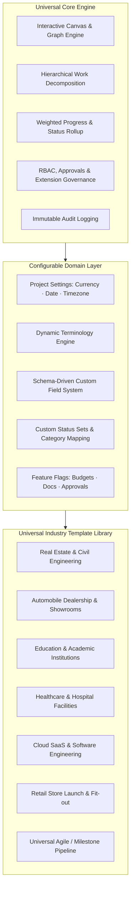

# Chunk 0 — Repository Audit & Universal Platform Implementation Plan

**Role:** Lead Software Architect  
**Project:** Universal FlowTrack Platform  
**Repository:** `Project-managment-app/`  
**Status:** Audit & Architecture Planning Complete — Ready for Chunk 1 Approval  

---

## Executive Summary

FlowTrack has a strong foundation: a modern **pnpm monorepo** consisting of a React 19/Vite frontend, a NestJS 10 backend, and a shared TypeScript/Zod domain engine (`@flowtrack/shared`). It features an interactive React Flow canvas, node hierarchy, weighted progress rollups, role-based authorization, and an initial template structure.

However, the application was originally seeded around a real estate/township development example and lacked a unified, server-driven configurability engine. Transforming FlowTrack into a **Universal Project-Management Platform** requires separating the **reusable domain core** (canvas, nodes, edges, hierarchy, progress, permissions, governance) from **configurable industry blueprints** (terminology, currencies, date formats, workflow gates, custom fields, and stage-gate presets).

All findings below are based on actual code inspection and verified test/build runs.

---

## 1. Current Architecture Summary

The repository is structured as a pnpm workspace with three primary packages:

```
flowtrack-monorepo/
├── apps/
│   ├── api/           # NestJS 10 REST API + Prisma 6 + Passport JWT + Swagger
│   └── web/           # React 19 + Vite 6 + React Flow 12 + Tailwind CSS + Zustand
├── packages/
│   └── shared/        # Shared pure TypeScript domain logic, Zod schemas, Vitest tests
├── docs/              # Setup and architecture documentation
├── docker-compose.yml # PostgreSQL 16, Redis 7.2, MinIO
└── package.json       # Monorepo scripts with pnpm filters
```

### Component Details

| Layer | Technologies & Libraries | Current Architecture Status |
|---|---|---|
| **Frontend** (`apps/web`) | React 19, `@xyflow/react` (v12.4.2), Tailwind CSS 3, Zustand 5, Lucide React, i18next | Client-rendered SPA. Navigation between Dashboard view and Canvas Studio. State managed locally via Zustand stores (`authStore`). API communication handled through `ApiClient`. |
| **Backend** (`apps/api`) | NestJS 10, Prisma ORM 6, Passport JWT, Swagger (`/api/docs`), Express | Modular architecture: `AuthModule`, `WorkspacesModule`, `ProjectsModule`, `NodesModule`, `EdgesModule`, `NodeTypesModule`, `TemplatesModule`. Global validation pipe with whitelist transform. |
| **Shared** (`packages/shared`) | TypeScript 5.7, Zod 3.24, Vitest 3.0 | Pure domain layer without I/O. Contains Zod schemas for all domain entities, calculation engine (`calculateGroupRollup`, `isNodeOverdue`), and universal industry constants. Built using `tsup` into dual CJS/ESM + DTS bundles. |
| **Database** | PostgreSQL 16 (via Prisma ORM 6) | Relational schema in `prisma/schema.prisma`. 14 models covering tenancy, users, projects, node types, field definitions, nodes, edges, remarks, chat, documents, templates, and audit logs. |
| **Build & Test** | Vitest, Vite, Nest CLI, Tsup | Monorepo test suite: `pnpm test` executes Vitest across `packages/shared` (15/15 passing), `apps/api` (2/2 passing), and `apps/web` (3/3 passing). |

---

## 2. Feature Inventory

| Capability | Status | Implementation Details & Observations |
|---|---|---|
| **Monorepo & Dependency Management** | **Verified** | `pnpm` workspaces configured, native build scripts approved, packages link via `workspace:*`. |
| **Authentication & Tenancy** | **Verified** | JWT auth, email/password login & registration, mock phone OTP, tenant isolation via `workspaceId`. |
| **Role-Based Permissions (RBAC)** | **Verified** | 5 roles defined (`ADMIN`, `MANAGER`, `TEAM_LEAD`, `MEMBER`, `GUEST`). Frontend permission helpers in `apps/web/src/utils/permissions.ts`. |
| **Visual Canvas Studio** | **Verified** | React Flow 12 infinite canvas, 4-directional connection handles, custom sequence edges with midpoint insertion `(+)`, Dagre auto-layout (LR and TB). |
| **Node Hierarchy & Sub-Canvases** | **Verified** | `parentNodeId` relational nesting, breadcrumb navigation, drill-down into stages and child groups. |
| **Task Dossier & Detail Drawer** | **Verified** | `NodeDetailDrawer.tsx` includes tabs for Remarks, Details, Approval, Children, Documents, and History. |
| **Weighted Progress Rollup** | **Verified** | Implemented in `packages/shared/src/calculation/rollup.ts`. 100% unit-tested with Vitest. |
| **Audit Trail & History** | **Verified** | `AuditLog` records actor, action, oldValues, and newValues. Endpoints exist at `GET /nodes/:id/history`. |
| **Document Management** | **Verified** | Local/DB metadata in `Document` model. Endpoints exist at `POST /nodes/:id/documents` and `GET /nodes/:id/documents`. |
| **Industry Templates Engine** | **Verified** | Server-side `TemplatesModule` with database persistence, industry metadata, and transactional project instantiation. |
| **Custom Field Validation** | **Partial** | Database supports `FieldDefinition` with JSON `options`, and nodes store `customData` in JSONB. Dynamic server-side validation against field definitions is not yet enforced on node updates. |
| **Manager Approval Gates** | **Partial** | UI elements exist in `NodeDetailDrawer.tsx` (approval note, approve/reject button). Backend dedicated approval state transition endpoint is combined with generic node updates. |
| **Deadline Extension Governance** | **Partial** | `DeadlineExtensionModal.tsx` exists on the frontend. Dedicated governed extension request and sign-off API contract needs formalization. |
| **Multilingual Localization** | **Partial** | `i18next` configured with English, Hindi, and Kannada for standard UI strings. Industry terminology override engine not yet hooked into translations. |
| **Universal Currency & Date Formatting** | **Partial** | Supported currencies defined in shared constants; frontend display formatting currently hardcodes default symbols in certain canvas badges. |
| **Real-time Collaboration & WebSocket** | **Missing** | `@nestjs/websockets` and `socket.io` installed in `apps/api/package.json`, but gateway handlers for canvas cursor sync and live updates are stubs. |
| **MinIO / S3 Object Storage Upload** | **Missing** | Documents currently store metadata; direct presigned upload/download integration with MinIO/S3 is not yet connected to the file upload handler. |
| **Background Queue / BullMQ** | **Missing** | BullMQ and Redis dependencies present in `package.json`, but queue worker processor for background reminders/digests is not active. |

---

## 3. Gap Analysis Against Universal Platform Vision

| Universal Platform Requirement | Existing State | Required Architectural Evolution |
|---|---|---|
| **Multi-Industry Support** | Was centered around real estate/construction township creation. | Configurable industry schemas where any project can declare its industry, methodology, terminology, and features. |
| **Configurable Terminology** | Fixed terms ("Stage", "Task", "Subtask", "Owner"). | Terminology map per project (e.g., Construction uses "Work Package/Site Engineer", Education uses "Course Module/Faculty", Healthcare uses "Clinical Protocol/Dept Head"). |
| **Currency & Regional Settings** | Assumed USD / local default. | Per-project currency configuration (code, symbol, placement) and date format (`DD/MM/YYYY`, `YYYY-MM-DD`). |
| **Dynamic Task Forms & Fields** | Hardcoded fields in drawer with unstructured `customData`. | Schema-driven field definitions rendered dynamically with type validation (text, number, currency, date, select, multiselect, user, file). |
| **Configurable Workflows & Gates** | Linear sequence edges with hardcoded status set. | Configurable status sets per node type, explicit approval gate conditions, and automated status transition rules. |
| **Modular Feature Toggling** | All UI elements visible for all projects. | Project-level feature flags (e.g. `budgetTracking`, `approvals`, `voiceRemarks`, `confidentialDocs`) controlling UI tabs and capabilities. |

---

## 4. Current Database Model & Additive Changes

### Current Prisma Models
- `Workspace`: Tenancy root with `themeSettings`
- `User`: Accounts with authentication credentials, locale
- `Membership`: User-to-Workspace relation with `Role` enum
- `Project`: Project root with `settings Json?`, `templateId`
- `NodeType`: Configurable node types with `icon`, `colour`, `isGroup`
- `FieldDefinition`: Dynamic custom fields per node type
- `StatusSet` & `Status`: Configurable status sets with categories and labels
- `Node`: Canvas items with `customData Json?`, hierarchy, priority, progress
- `Edge`: Canvas directed connections with `kind`, `metadata Json?`
- `Remark`: Timeline entries with text, voiceUrl, photoUrl
- `ChatThread` & `ChatMessage` & `ChatRead`: Node/project collaboration threads
- `Document`: File vault entries with mimeType, fileSize, scanStatus
- `AuditLog`: Action logs with JSON diffs
- `Template`: Reusable project blueprints
- `AutomationRule`: Workflow triggers and actions (draft model)

### Recommended Additive (Non-Destructive) Changes
1. **`Project.settings` typing**: Formalize `settings` structure to store `industry`, `methodology`, `currency`, `dateFormat`, `timezone`, `terminology`, and `features` while preserving existing JSONB records.
2. **`Template` enhancements**: Additive columns already applied safely (`industry`, `methodology`, `icon`, `tags`, `defaultSettings`, `nodeTypes`, `statusSets`).
3. **`FieldDefinition.validationRules`**: Optional JSON field for min/max, regex, and conditional visibility.
4. **`Node.approvalData`**: Structured JSON field for approver ID, timestamp, approval status, and feedback notes.

---

## 5. Target Architecture



---

## 6. Ordered Implementation Roadmap

| Chunk | Phase Title | Scope & Key Deliverables | Dependencies | Risk Assessment |
|---|---|---|---|---|
| **Chunk 1** | **Universal Project Settings & Dynamic Terminology Engine** | Full UI and API integration of project settings: currency selector, date formatting, and terminology dictionary. Canvas and Drawer dynamically adapt labels ("Task", "Phase", "Owner", etc.). | Chunk 0 | **Low**: Purely additive; defaults ensure complete backward compatibility. |
| **Chunk 2** | **Configurable Industry Template Library & Blueprint Seeding** | Server-side template repository, categorized template browser in modal with filters, and transactional project generation from templates. | Chunk 1 | **Low**: Template models already exist; replaces brittle client-side loops. |
| **Chunk 3** | **Schema-Driven Custom Fields & Dynamic Dossier Form** | Field definition manager for node types, dynamic form rendering in `NodeDetailDrawer`, server-side validation against `FieldDefinition`. | Chunk 1 | **Medium**: Form state management in drawer needs clean isolation. |
| **Chunk 4** | **Governed Approval Gates & Formal Deadline Extension Workflow** | Explicit approval endpoints, manager sign-off with mandatory rejection rationale, auditable deadline extension requests with reason and document attachment. | Chunk 3 | **Medium**: Requires backend permission enforcement on update transitions. |
| **Chunk 5** | **Universal Reporting, Dashboards & Export Engine** | Project health KPI cards formatted with project currency, exportable CSV/PDF summaries adapting to project terminology and methodology. | Chunk 1, 4 | **Low**: Read-only aggregation and presentation. |

---

## 7. API Compatibility & Data Migration Concerns

1. **Backward Compatibility**:
   - Existing endpoints (`GET /projects`, `POST /projects`, `GET /nodes`, etc.) must not break existing clients.
   - Any project created without explicit `settings` will automatically receive the `general` default settings through shared schema defaults.
2. **Database Integrity**:
   - No destructive migrations (`DROP COLUMN`, `TRUNCATE`, `DROP TABLE`).
   - All newly added columns on `templates` and `projects` use safe nullable types or `@default(...)`.
3. **Optimistic Concurrency**:
   - Preserved `version` integer on `Project` and `Node` models to prevent race conditions during collaborative updates.

---

## 8. Test Strategy

1. **Shared Unit Tests** (`packages/shared`):
   - Schema validation for universal project settings, industry terminology, and template structures.
   - Rollup engine calculations for weighted progress and overdue checks.
2. **Backend Integration Tests** (`apps/api`):
   - Service tests for `TemplatesService` and `ProjectsService` verifying transactional creation, settings persistence, and isolation.
   - Endpoint test coverage for template instantiation.
3. **Frontend Component & Helper Tests** (`apps/web`):
   - Permissions helper tests (`permissions.spec.ts`).
   - Dynamic currency/date formatting tests.
4. **End-to-End Build Verification**:
   - Clean execution of `pnpm run build` across all three workspace projects.

---

## 9. Smallest Useful First Implementation Milestone (Chunk 1)

### Proposed Scope for Chunk 1:
**Universal Project Settings & Dynamic Terminology Engine**
- **Shared**: Refine and freeze `projectSettingsSchema`, currency formatters, and industry terminology lookups.
- **Backend**: Ensure `Project` endpoints accept, validate, and return comprehensive `settings`.
- **Frontend**: 
  - Integrate dynamic currency display (e.g. ₹, $, €, £) across Project Cards, Canvas nodes, and Detail Drawer.
  - Integrate dynamic terminology so labels across the app reflect the configured industry (e.g., showing "Phase" instead of "Stage", "Inspection" instead of "Task", "Contractor" instead of "Owner").
  - Add Project Settings modal/tab to edit these properties on existing projects.
- **Verification**: Monorepo build and automated tests pass.

---

> **Stopping Condition:** Chunk 0 Audit & Implementation Plan complete. Awaiting user approval before proceeding to Chunk 1.
