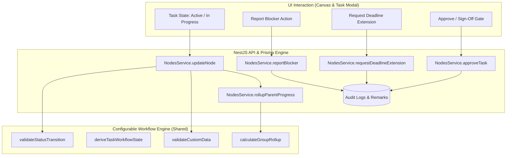

# UNIVERSAL FLOWTRACK — CHUNK 4 IMPLEMENTATION SUMMARY
## Universal Task Management and Configurable Workflow Engine

---

### Executive Overview

**Chunk 4** establishes a configurable, industry-agnostic task-management engine within FlowTrack. Rather than writing distinct engines for construction, education, automotive, or IT projects, domain differences (e.g. municipal inspection permits vs accreditation certificates vs code reviews) are modeled through **configurable status sets**, **generic field validation**, **deterministic progress rollups**, and **completion gates**.

---

### 1. Workflow Requirements & Core Rules

| Requirement # | Core Rule | Implementation Details |
|---|---|---|
| **Rule 1 & 2** | **Configurable Status Names, Transitions & Sets** | Status sets belong to project templates/types. If allowed transitions are defined on a status, transitions violating them fail with `INVALID_TRANSITION`. |
| **Rule 3** | **Mandatory Fields & Completion Criteria** | Validated via generic `validateCustomData`. Tasks transitioning to `done` must satisfy all mandatory custom fields defined by the task's node type; otherwise fails with `FIELDS_REQUIRED`. |
| **Rule 4** | **Enforceable Dependency Satisfaction** | Visual edges (`sequence`, `related`) are non-blocking. Edges with `kind: 'dependency'` are strictly enforceable; dependent tasks cannot complete or start while source tasks remain incomplete (`DEPENDENCY_BLOCKED`). |
| **Rule 5** | **Distinguishing Blocked vs Delayed Tasks** | Runtime workflow derivation separates tasks that are *delayed/overdue* (past due date, positive delay hours) from tasks that are *actively blocked* (waiting on unsatisfied prerequisites or marked blocked). The canvas renders a distinct **Red Blocker Banner** (`🚫 Blocked by: [Task]`) vs an **Amber Clock Banner** (`⚠️ DELAYED: [Time]`). |
| **Rule 6** | **Reviewer and Approval Responsibilities** | Designated reviewer (`reviewerId`) or Manager/Admin can sign off via `POST /nodes/:id/approve`. Milestone and approval gates cannot complete until verified (`approvalStatus === 'approved'`), preventing bypass with `APPROVAL_REQUIRED`. |
| **Rule 7 & 8** | **Deterministic Parent Progress Rollup & Child Guard** | Parent groups deterministically compute weighted progress `sum(progressPct * weight) / sum(weight)` via `calculateGroupRollup`. A parent task cannot transition to `done` while child tasks remain open (`CHILDREN_OPEN`). |
| **Rule 9** | **Consistent Overdue Derivation** | Derived at runtime comparing task `dueDate` against current timestamp, excluding closed statuses (`done`, `cancelled`). |
| **Rule 10** | **Audit Records & Task History** | Meaningful actions (`STATUS_CHANGE`, `ASSIGNMENT_CHANGE`, `APPROVAL_DECISION`, `BLOCKER_REPORTED`, `DEADLINE_CHANGE`) record prior and new values in `audit_logs` and post system remarks in the task discussion thread. |

---

### 2. Delivered API Endpoints

- `PATCH /nodes/:id`: Enforces workflow validation (`validateStatusTransition`), triggers recursive parent progress rollup, and audits assignment and deadline adjustments.
- `POST /nodes/:id/approve`: Validates reviewer identity and project/workspace permissions, updates `approvalStatus`, records `APPROVAL_DECISION` audit log, and creates approval remarks.
- `POST /nodes/:id/blocker`: Switches status to blocked, records `BLOCKER_REPORTED` audit log with blocker reason, and adds system notice.
- `POST /nodes/:id/deadline-extension`: Validates new schedule, updates `dueDate`, records `DEADLINE_CHANGE` audit log with justification, and posts schedule alert.
- `GET /nodes/:id`: Returns serialized documents, rollup progress, `derivedWorkflow` state, and `blockingPrerequisites`.

---

### 3. UI Integration Summary

- **Visual Canvas Nodes (`FlowTrackNode.tsx`):**
  - Distinct Red Banner for blocked tasks with prerequisite task title.
  - Distinct Amber Banner for overdue/delayed tasks with active countdown timer.
  - Reviewer avatar and approval gate indicator icons (`ShieldCheck`, `ShieldX`, `ShieldAlert`).
- **Task Detail & Dossier Modal (`NodeViewDetailsModal.tsx`):**
  - **Workflow Gates & Readiness Card**: Live checklist for Prerequisites, Child Subtasks, Mandatory Fields, and Review Gate.
  - **Inline Blocker Reporting Form**: Submit active site blockers directly.
  - **Reviewer Selection**: Assign and track designated reviewers.
  - **Dual Review Decision Controls**: Approve & Sign Off (`thumbs_up`) or Request Rework (`thumbs_down`) with audited feedback notes.
- **Node Detail Drawer (`NodeDetailDrawer.tsx`):**
  - Designated reviewer dropdown and integrated approval action buttons.

---

### 4. Verification & Automated Test Coverage

The monorepo test suite passed with **93 tests out of 93 passing** (0 failures):

- **`@flowtrack/shared` (46 tests):** Status transitions, cycle detection, hierarchy isolation, field validator, and deterministic group rollup.
- **`@flowtrack/api` (23 tests):** Transition validation guards (`CHILDREN_OPEN`, `DEPENDENCY_BLOCKED`, `FIELDS_REQUIRED`, `APPROVAL_REQUIRED`), progress rollup calculations, reviewer permissions, blocker reporting, and deadline extensions.
- **`@flowtrack/web` (24 tests):** Universal task workflow state derivations, delayed vs blocked separation, permission roles, and canvas interaction controls.
- **Production Builds:** Verified clean builds for `@flowtrack/shared` (`tsup`), `@flowtrack/api` (`nest build`), and `@flowtrack/web` (`vite build`).

---

> [!IMPORTANT]
> **Stop Condition Met:** Per user instructions, Chunk 4 is complete. Chunk 5 will not begin until this phase is reviewed.
