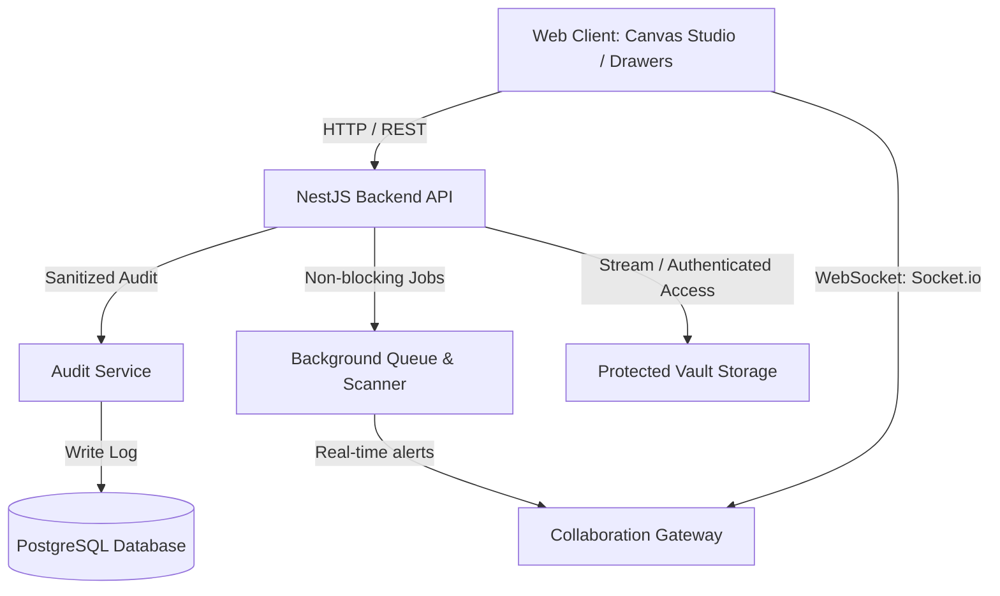

# CHUNK 6: FILES, AUDIT, COLLABORATION AND NOTIFICATIONS

## Overview

Chunk 6 strengthens multi-user collaboration in FlowTrack while strictly enforcing security, audit compliance, storage safety, and real-time synchronization.

Authorized project members can upload deliverables and inspection evidence, designated reviewers and managers can verify or request rework with clear feedback, every business event is captured in a sanitized audit history, and real-time notifications and canvas updates keep team members aligned without duplicate alerts or blocking delays.

---

## 1. Architecture & Security Model

### Key Security Safeguards
1. **Zero Raw File Exposure**: File physical disk paths and cloud storage keys are never exposed in client responses. Documents are assigned safe keys (`vault://${filename}`) and served exclusively through authenticated streaming endpoints (`GET /api/nodes/:nodeId/documents/:id/download`).
2. **Strict File Type Whitelisting & Extension Blacklisting**: Executable, binary script, and malicious formats (`.exe`, `.bat`, `.cmd`, `.sh`, `.php`, `.py`, `.vbs`, `.js`, etc.) are prohibited. Document size is capped at 25MB (`MAX_DOCUMENT_SIZE_BYTES = 26,214,400`).
3. **Workspace & Role Authorization**: Document upload, retrieval, and deletion enforce workspace membership and node ownership. Evidence verification is restricted to designated task reviewers and workspace Managers/Admins.
4. **Audit Data Sanitization**: Sensitive keys (`password`, `passwordHash`, `token`, `secret`, `authorization`, `apiKey`, `jwt`) are recursively stripped and replaced with `[REDACTED]` before writing to `AuditLog`.
5. **Notification Deduplication**: Database unique constraint `@@unique([userId, dedupKey])` guarantees that repeated background job scans, retries, or rapid user actions never spawn duplicate notifications.

---

## 2. Document & Evidence Deliverable Lifecycle

### Supported Categories
- `evidence`: Verified deliverable inspection evidence (photos, test reports, logs).
- `deliverable`: Primary milestone or task deliverable (blueprints, CAD/DWG, code bundles).
- `specification`: Requirements, schematics, engineering specs.
- `contract`: Signed agreements, quotes, NDAs.
- `general`: Standard files and working attachments.

### Automated Versioning
When a user uploads a revised file with the same filename on a task node:
- The system increments the version counter (`nextVersion = existing.version + 1`).
- The previous version is archived in document metadata (`metadata.previousVersionId`).
- Both versions remain distinct and verifiable in audit history.

### Evidence Verification Workflow
1. **Submission**: Assignee uploads deliverable evidence in `NodeDetailDrawer`.
2. **Notification**: Reviewer receives an `APPROVAL_REQUEST` notification in real-time.
3. **Inspection**: Reviewer opens the drawer, previews or downloads the evidence.
4. **Decision**:
   - **Verify & Approve**: Status set to `APPROVED`, uploader notified via `APPROVAL_DECISION`, task unblocked for review gate completion.
   - **Request Rework**: Reviewer enters required feedback, status set to `REJECTED`, uploader notified with feedback to submit revised deliverable.
5. **Audit Event**: Recorded as `EVIDENCE_APPROVED` or `EVIDENCE_REWORK_REQUESTED`.

---

## 3. Real-Time Collaboration Infrastructure

### Socket.io Gateway
- **Project Room** (`project:${projectId}`):
  - `node:created`: Collaborator adds a new task/stage.
  - `node:updated`: Status transitions, progress rollups, priority, or field changes.
  - `nodes:positions_updated`: Live multi-user canvas node movement and auto-layout.
  - `node:blocked`: Immediate visual alert when a task is flagged as blocked.
  - `node:deleted`: Removes task from canvas in real-time.
  - `node:remark_added`: Live comment stream update.
- **User Room** (`user:${userId}`):
  - `notification:received`: Dispatches instant notifications, increments unread badge.
- **Node Room** (`node:${nodeId}`):
  - Targeted drill-down and sub-canvas inspectors.

---

## 4. Background Jobs & Notification Scanner

The `BackgroundJobsService` provides an in-process, non-blocking asynchronous queue and periodic scanner:
- **Async Queue**: Asynchronous tasks (real-time notification emission, audit indexation, heavy notifications) are processed outside the critical request-response cycle.
- **Deadline Reminder Scanner**: Runs every 10 minutes to detect tasks due within 48 hours or overdue. Dispatches `DEADLINE_REMINDER` notifications to task owners with deduplication keys formatted as `deadline_reminder:${nodeId}:${dateBucket}` to guarantee zero duplicate alerts.

---

## 5. UI Collaboration Surfaces

1. **Top Navbar Notification Bell & Drawer**:
   - Real-time unread badge counter (`99+` support, animated pulse).
   - Slide-over drawer with category filters (`All`, `Unread`, `Assignments`, `Gates`, `Blockers`).
   - Single-click "Mark Read" and "Mark All as Read".
   - Direct task jump link to open the referenced task directly on the canvas.
2. **Project Activity Stream Modal** (`ProjectActivityModal`):
   - Access via the **Activity** button in the canvas toolbar.
   - Displays chronological project audit events with user avatars, timestamps, and formatted before/after changes.
   - Filter dropdown by action type (`Status Changes`, `Assignments`, `Deadlines`, `Sign-Offs`, `Evidence`).
3. **Node Documents & Evidence Management** (`NodeDetailDrawer`):
   - Category selection pills (`Deliverable Evidence`, `Technical Spec`, `Contract`, `General`).
   - Dropzone with 25MB limit and script/executable blocking.
   - Version tag badges (`v1`, `v2`).
   - Deliverable verification controls for managers/reviewers with feedback prompts.
   - Direct authenticated file streaming download.

---

## 6. Automated Test Coverage

| Test Suite | Total Tests | Status |
|:---|:---:|:---:|
| `apps/api/src/modules/audit/audit.service.spec.ts` | 4 | ✅ Passed |
| `apps/api/src/modules/notifications/notifications.service.spec.ts` | 4 | ✅ Passed |
| `apps/api/src/modules/documents/documents.service.spec.ts` | 4 | ✅ Passed |
| `apps/api/src/modules/nodes/nodes.service.spec.ts` | 9 | ✅ Passed |
| `apps/api/src/modules/projects/projects.service.spec.ts` | 4 | ✅ Passed |
| `apps/api/src/modules/field-definitions/field-definitions.service.spec.ts` | 7 | ✅ Passed |
| `apps/api/src/modules/templates/templates.service.spec.ts` | 5 | ✅ Passed |
| `apps/api/src/modules/auth/roles.guard.spec.ts` | 5 | ✅ Passed |
| `apps/web/src/components/canvas/collaboration.spec.ts` | 5 | ✅ Passed |
| `apps/web/src/components/canvas/task-workflow.spec.ts` | 7 | ✅ Passed |
| `apps/web/src/components/custom-fields/custom-fields.spec.ts` | 7 | ✅ Passed |
| `apps/web/src/components/canvas/canvas-interaction.spec.ts` | 14 | ✅ Passed |
| `apps/web/src/utils/permissions.spec.ts` | 3 | ✅ Passed |
| `packages/shared/src/domain/custom-fields-validator.spec.ts` | 18 | ✅ Passed |
| `packages/shared/src/domain/workflow.spec.ts` | 10 | ✅ Passed |
| `packages/shared/src/domain/hierarchy.spec.ts` | 8 | ✅ Passed |
| `packages/shared/src/domain/dependencies.spec.ts` | 8 | ✅ Passed |
| `packages/shared/src/calculation/rollup.spec.ts` | 9 | ✅ Passed |
| `packages/shared/src/domain/template-instantiation-isolation.spec.ts` | 1 | ✅ Passed |
| `packages/shared/src/schemas/template.spec.ts` | 6 | ✅ Passed |
| **Monorepo Total** | **138 Tests** | **100% Passing** |
