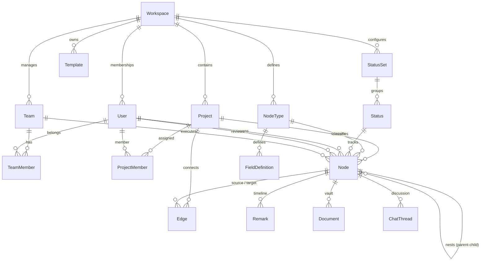

# Universal FlowTrack — Domain Model & Schema Documentation

## 1. Universal Domain Core Architecture

FlowTrack uses a unified, multi-industry domain model that represents work across any sector (Construction, Dealerships, Education, Healthcare, IT, Retail, Governance) without creating siloed, industry-specific database tables.

Instead, the core entities model the fundamental physics of project delivery:
- **Tenancy & Organization**: `Workspace`, `User`, `Membership`, `Team`, `TeamMember`, `ProjectMember`
- **Work Breakdown & Hierarchy**: `Project`, `NodeType`, `Node` (self-referential hierarchy via `parentNodeId`), `FieldDefinition`
- **Workflow & Scheduling**: `Edge` (directed graph with cycle prevention), `StatusSet`, `Status`, `AutomationRule`
- **Governance & Collaboration**: `Remark`, `Document`, `ChatThread`, `ChatMessage`, `AuditLog`
- **Universal Templates**: `Template` (complete blueprint with industry metadata, graph topology, node types, and default settings)

---

## 2. Universal Entities Reference

### 2.1 Project (`projects`)
The top-level container for a project delivery initiative.
- `id`: UUID primary key
- `workspaceId`: Tenant workspace
- `name`: Human-readable name
- `description`: Scope and objectives
- `templateId`: Source blueprint ID (optional)
- `status`: Lifecycle status (`ACTIVE`, `ARCHIVED`, `COMPLETED`)
- `startDate` & `targetDate`: High-level delivery window
- `version`: Optimistic concurrency lock integer
- `settings`: Structured JSONB representing `ProjectSettingsDto`:
  - `industry`: `construction_real_estate` | `automotive_dealerships` | `education_academics` | `healthcare_hospital` | `it_software` | `retail_hospitality` | `general`
  - `methodology`: `stage_gate` | `agile_sprint` | `linear_milestone` | `process_pipeline` | `hybrid`
  - `currency`: `{ code: string, symbol: string, name?: string }`
  - `dateFormat`: `'YYYY-MM-DD'` | `'DD/MM/YYYY'` | `'MM/DD/YYYY'`
  - `timezone`: e.g. `'Asia/Kolkata'`, `'UTC'`, `'America/New_York'`
  - `terminology`: Dynamic label dictionary (`stage`, `task`, `subtask`, `milestone`, `owner`, `approver`)
  - `features`: Feature toggles (`budgetTracking`, `approvals`, `voiceRemarks`, `evidenceUpload`, `confidentialDocs`, `auditTrail`)

### 2.2 Node (`nodes`)
The universal primitive for any work item (Phase, Stage, Sprint, Work Package, Task, Inspection, Subtask, Milestone).
- `id`: UUID primary key
- `projectId` & `workspaceId`: Scoping foreign keys
- `parentNodeId`: Parent node for nested sub-canvases (max depth: 5 levels, cycle-free)
- `nodeTypeId`: Classification (`task`, `stage`, `approval`, `milestone`, `doc_request`)
- `statusId`: Current lifecycle status
- `ownerId`: Primary assignee (`User`)
- `reviewerId`: Designated approver/reviewer (`User`)
- `teamId`: Assigned team/contractor/department (`Team`)
- `title` & `description`: Item title and rich description
- `positionX` & `positionY`: Infinite canvas 2D coordinates
- `width` & `height`: Node rendering dimensions
- `priority`: `LOW` | `MEDIUM` | `HIGH` | `URGENT`
- `weight`: Relative impact on parent group rollup (default: 1.0)
- `progressPct`: Progress from 0 to 100%
- `isMilestone`: Boolean flag for high-visibility contractual/regulatory gates
- `milestoneDueDate`: Contractual deadline for the milestone
- `startDate` & `dueDate`: Scheduled execution dates
- `estimatedCost` & `actualCost`: Decimal(14, 2) budget and cost tracking
- `allocatedHours` & `actualHours`: Decimal(8, 2) resource effort tracking
- `currency`: ISO currency code (`INR`, `USD`, `EUR`, `GBP`)
- `approvalStatus`: `not_required` | `pending` | `approved` | `rejected`
- `approvedAt` & `approvalFeedback`: Sign-off metadata
- `customData`: Dynamic key-value pairs validated against `FieldDefinition`

### 2.3 Edge (`edges`)
Directed connections expressing dependencies and sequences on the canvas.
- `id`: UUID primary key
- `sourceNodeId` & `targetNodeId`: Connected nodes (self-loops rejected)
- `kind`: `sequence` (blocking order) | `dependency` (blocking prerequisite) | `related` (non-blocking informational)
- `label`: Edge descriptive badge
- `metadata`: Flexible edge attributes (lag time, constraints)
- **Constraint**: Pure graph cycle detection ensures no circular blocking dependencies can be created.

### 2.4 Team & TeamMember (`teams`, `team_members`)
Organizes users into functional squads, site contractor crews, academic boards, or clinical departments.
- `id`, `workspaceId`, `name`, `description`, `colour`
- `TeamMember`: Associates `userId` with role (`lead` | `member`).

### 2.5 ProjectMember (`project_members`)
Explicit project-level membership and role delegation.
- `projectId`, `userId`, `role` (`ADMIN`, `MANAGER`, `TEAM_LEAD`, `MEMBER`, `GUEST`).

### 2.6 Document (`documents`)
The file vault supporting evidence uploads, contracts, CAD drawings, and inspection reports.
- `name`, `mimeType`, `fileSize`, `storageKey`, `version`, `scanStatus`
- `category`: `general` | `evidence` | `contract` | `inspection` | `specification` | `signoff`

---

## 3. Core Domain Engines & Business Rules

All domain rules are implemented as pure, zero-I/O TypeScript functions in `@flowtrack/shared` and validated with 100% test coverage:

1. **Hierarchy Engine (`src/domain/hierarchy.ts`)**:
   - `validateParentAssignment`: Prevents self-nesting, cyclic ancestry, and depth exceeding `MAX_HIERARCHY_DEPTH = 5`.
   - `getBreadcrumbPath`: Computes the breadcrumb trail from root to current node.
   - `getDescendantIds`: Retrieves all transitive descendants using BFS.

2. **Graph Dependency Engine (`src/domain/dependencies.ts`)**:
   - `validateDependencyEdge`: Uses path-tracking DFS to detect direct and indirect cycles before committing edges.
   - `topologicalSort`: Determines executable sequence order across tasks.

3. **Custom Fields Validator (`src/domain/custom-fields-validator.ts`)**:
   - `validateCustomData`: Validates types (`text`, `number`, `currency`, `date`, `select`, `multiselect`, `checkbox`, `link`), choices, and required constraints.

4. **Workflow & Status Engine (`src/domain/workflow.ts`)**:
   - `validateStatusTransition`: Prevents marking a parent group `done` while children are open, and blocks approval gate completion without manager sign-off.

5. **Weighted Progress Rollup Engine (`src/calculation/rollup.ts`)**:
   - Computes weighted percentage rollup, blocker propagation, and overdue state.

---

## 4. Multi-Industry Acceptance Mapping

The same underlying domain entities represent diverse industries without schema changes:

| Concept | Construction Project | Automobile Dealership | Education Campus | IT Cloud Software |
|---|---|---|---|---|
| **Root Node** | Construction Township | Dealership Facility | Academic Department | SaaS Platform |
| **Stage Node** | Foundation & Civil | Workshop Service Bays | Syllabus Curriculum | Sprint 14 Microservices |
| **Task Node** | Pouring Concrete Piles | Hydraulic Lift Tooling | Faculty Appointment | REST API Build |
| **Milestone** | Quality Occupancy NOC | OEM Launch Audit | NAAC Accreditation Gate | Cloud Production Cutover |
| **Owner** | Site Engineer | Department Head | Course Coordinator | Tech Lead / Engineer |
| **Reviewer** | Chief Architect | General Manager | Academic Dean | Principal Architect |
| **Team** | Civil Contractor Crew | Diagnostic Workshop Squad| Board of Studies | DevOps / Backend Squad |
| **Document Category**| `inspection` (Soil Test) | `evidence` (OEM Checklist) | `contract` (Faculty MoU)| `specification` (ADR) |
| **Currency** | `INR (₹)` | `USD ($)` | `USD ($)` | `USD ($)` |
