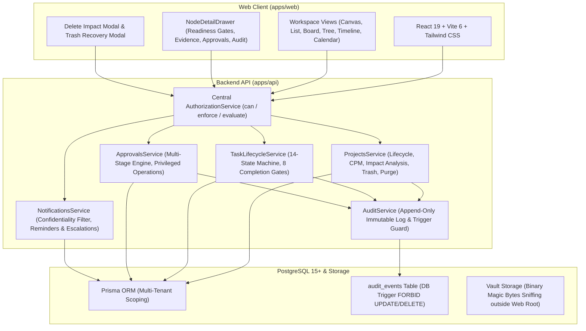

# FlowTrack PM Governance Platform — Architecture, Data Model & Runbook

**Version**: 3.0.0 (Phase 3 Completed)  
**Date**: 2026-10-29  
**Platform**: FlowTrack Enterprise Project Governance Engine

---

## 1. System Architecture

FlowTrack is built on a modular monorepo architecture engineered for deterministic workflow governance, audit non-repudiation, and multi-tenant security:



---

## 2. Core Relational Data Model

### A. Core Governance Entities
1. **`Workspace` (`workspaces`)**:
   - Multi-tenant boundary. All business entities carry foreign key `workspace_id`.
2. **`Department` (`departments`)**:
   - Hierarchical organizational unit with `parent_id` cycle prevention.
3. **`Position` (`positions`)**:
   - Enterprise position taxonomy with `reports_to_position_id` supervisor hierarchy. Job titles are labels decoupled from permissions.
4. **`ScopedRoleAssignment` (`scoped_role_assignments`)**:
   - Contextual role grants across `ORGANIZATION`, `DEPARTMENT`, `TEAM`, `PROJECT`, and `TASK` scopes.
5. **`AccessGrant` (`access_grants`)**:
   - Time-bound or permanent discretionary access grants for confidential resources (`valid_until`, `revoked_at`, `access_level`).

### B. Project & Task Entities
1. **`Project` (`projects`)**:
   - `id`, `workspace_id`, `name`, `key` (unique per workspace, e.g. `PRJ-ALPHA`), `classification` (`PUBLIC_INTERNAL`, `INTERNAL`, `RESTRICTED`, `CONFIDENTIAL`, `HIGHLY_CONFIDENTIAL`), `status` (`ACTIVE`, `ARCHIVED`, `DELETED`), `settings` JSON, `version` (optimistic lock), `deleted_at`.
2. **`Node` (`nodes`)**:
   - Universal task entity. `parent_node_id`, `materialized_path`, `depth` ($\le 10$), `state` (14 states), `progress_pct`, `weight`, `is_required`, `mandatory_evidence_count`, `version`.
3. **`Edge` (`edges`)**:
   - Directed dependencies between tasks with DFS cycle detection. Cross-project dependencies link external tasks.

### C. Workflow, Evidence & Approvals Entities
1. **`work_submissions`**:
   - Append-only, versioned work submissions (`version`, `notes`, `submitted_by_id`, `submitted_at`).
2. **`evidence_items`**:
   - Validated artifacts attached to tasks (`category`, `sha256_hash`, `file_size`, `mime_type`, `vault_path`).
3. **`approval_policies` & `policy_stages`**:
   - Configurable selectors (`task_type`, `risk_level`, `budget_threshold`, `confidentiality`, `department_id`, `operation_type`), versioned immutably (`v1`, `v2`).
4. **`approval_requests`, `approval_stage_instances`, `approval_decisions`**:
   - Decoupled approval workflow. Decisions record `decision` (`APPROVED`, `REJECTED`, `CHANGES_REQUESTED`), `policy_version`, `submission_version`, and mandatory comment.
5. **`audit_events`**:
   - Immutable audit trail. Protected by PostgreSQL database trigger `trg_audit_events_immutable` preventing any `UPDATE` or `DELETE`.

---

## 3. API Route Catalog & Authorization Rules

| Method | Endpoint | Required Permission | Description |
| :--- | :--- | :--- | :--- |
| **GET** | `/projects` | `project.view` | List visible projects (filters confidential projects with 404). |
| **POST** | `/projects` | `project.create` | Create a new project with unique key. |
| **GET** | `/projects/:id` | `project.view` | Retrieve project metadata and custom fields. Returns 404 if unauthorized. |
| **PATCH** | `/projects/:id` | `project.edit` | Update project fields. Enforces optimistic lock `version`. Sanitizes system columns. |
| **GET** | `/projects/:id/deletion-impact` | `project.view` / `project.delete` | Calculate tasks, subtasks, documents, and external project dependencies. |
| **DELETE** | `/projects/:id` | `project.delete` | Soft-delete project into trash. Requires mandatory reason. Blocks if unforced external dependents exist. |
| **POST** | `/projects/:id/restore` | `project.restore` | Restore soft-deleted project and subtasks from trash. |
| **POST** | `/projects/:id/archive` | `project.archive` | Archive project. Independent of `project.edit`. Blocks mutations. |
| **POST** | `/projects/:id/unarchive` | `project.archive` | Restore archived project back to active state. |
| **GET** | `/projects/trash` | `project.restore` / `ADMIN` | List soft-deleted projects in workspace. Forbidden to standard members. |
| **POST** | `/projects/:id/purge` | `project.purge` / `ADMIN` | Permanent purge. Requires confirmation key, justification, and 30-day retention lock waiver. |
| **GET** | `/nodes/:id/completion-readiness` | `project.view` | Live evaluation of the 8 completion gates. |
| **POST** | `/nodes/:id/transition` | `task.update` / `task.complete` | Execute data-driven task transition with guards and validators. |
| **POST** | `/nodes/:id/submissions` | `work.submit` | Create immutable versioned work submission. |
| **POST** | `/nodes/:id/evidence` | `work.submit` | Upload validated binary evidence with magic bytes verification. |
| **GET** | `/nodes/:id/evidence/:evidenceId/download` | `project.view` | Protected file download checking auth and confidentiality on every request. |
| **POST** | `/approvals/requests` | `work.submit` / `operation.approve` | Initiate approval request for task submission or privileged operation. |
| **POST** | `/approvals/decisions` | `approve.task` / `approve.privileged` | Record approver decision. Submitter cannot self-approve. |
| **POST** | `/approvals/delegations` | `approve.task` | Delegate approval authority with explicit time window and justification. |
| **GET** | `/notifications` | Authenticated | Retrieve notifications with deduplication and unread counter. |
| **POST** | `/notifications/cron/escalations` | `ADMIN` / Scheduler | Check pending approval stages; trigger deadline reminders and overdue escalations. |
| **POST** | `/notifications/cron/overdue-reminders` | `ADMIN` / Scheduler | Check overdue tasks and dispatch alerts. |
| **GET** | `/audit/events` | `audit.view` | Search, filter, and inspect immutable audit trail with confidentiality redaction. |
| **GET** | `/audit/events/export` | `audit.export` | Export compliance audit trail to CSV or JSON format. |

---

## 4. Runbooks & How-To Guides

### Runbook 1: How to Configure Approval Policies
1. Navigate to `/approvals` or execute `POST /approvals/policies`:
   - Set `operationType`: `TASK_SUBMISSION`, `PROJECT_DELETION`, `DEADLINE_CHANGE`, or `BUDGET_INCREASE`.
   - Set selectors: `departmentId`, `taskType`, `riskLevel` (`CRITICAL`), `budgetThreshold` (e.g. `50000`).
2. Define stages:
   - Stage 1: `SEQUENTIAL`, `ALL_MUST_APPROVE`, Assigned Approver: Technical Lead.
   - Stage 2: `SEQUENTIAL`, `ANY_ONE_APPROVES`, Assigned Approver: Department Head, Escalation Target: VP Operations (`escalateAfterHours: 48`).
3. Updates to policies publish a new immutable version (`v2`, `v3`). All pending in-flight requests remain bound to the version they originated under.

### Runbook 2: End-to-End Project Execution
1. **Creation**: Create project with unique key `PRJ-BUILD` and classification `CONFIDENTIAL`.
2. **Decomposition**: Add tasks up to depth 10. Materialized paths are auto-computed.
3. **Execution & Blocker Reporting**: Assignee updates progress. If blocked, submit `POST /nodes/:id/work-updates` with reason; task switches to `Blocked`.
4. **Evidence Submission**: Assignee uploads completion report. Magic bytes validation checks `%PDF-` and prevents `.exe` masquerading.
5. **Approval**: Reviewer inspects submission. Separation of duties forbids submitter from self-approving.
6. **Completion**: Task evaluates 8 completion readiness gates (`GET /nodes/:id/completion-readiness`). Only when all 8 gates pass does the task transition to `Completed`, unblocking downstream dependents.

### Runbook 3: Lifecycle Safety (Archive, Delete, Trash, Restore & Purge)
1. **Archival**: Call `POST /projects/:id/archive`. Status becomes `ARCHIVED`. Task editing is locked.
2. **Impact Check**: Before deletion, call `GET /projects/:id/deletion-impact`. Inspect subtasks and external project dependencies.
3. **Soft-Delete**: Call `DELETE /projects/:id` with mandatory `{ reason: "Decommissioning" }`. Project is soft-deleted into trash (`status = 'DELETED'`).
4. **Trash Listing**: Authorized administrators call `GET /projects/trash` to inspect soft-deleted items.
5. **Restoration**: Call `POST /projects/:id/restore` with reason. Project and child tasks are restored to `ACTIVE`.
6. **Permanent Purge**: Restricted strictly to Workspace Administrators. Call `POST /projects/:id/purge` with `{ confirmationKey: "Project Name", justification: "Mandatory Retention Waiver", forceRetentionWaiver: true }`. Purges data while strictly retaining immutable audit events.

---

## 5. Verification Commands

```bash
# 1. Run Shared Domain Tests (130 tests)
pnpm --filter @flowtrack/shared test

# 2. Run API Security & Governance Tests (279 tests)
pnpm --filter @flowtrack/api test

# 3. Run Web UI Tests (217 tests)
pnpm --filter @flowtrack/web test

# 4. Run Monorepo Test Suite (626 tests total)
pnpm test

# 5. Build All Artifacts
pnpm --filter @flowtrack/shared build
pnpm --filter @flowtrack/api build
pnpm --filter @flowtrack/web build
```

