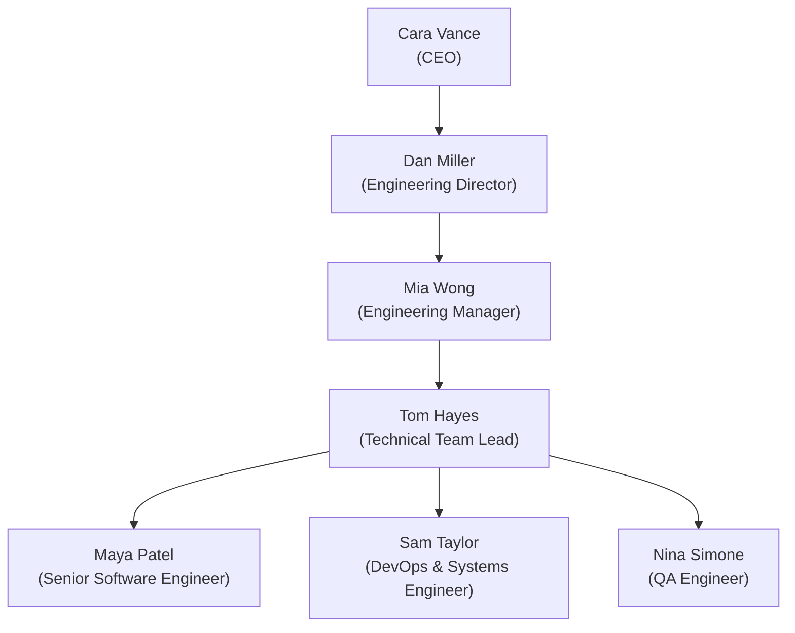
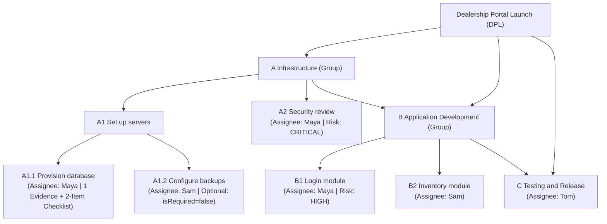

# FlowTrack Demo Dataset Guide (Seed & Teardown)

**Platform Version**: 3.0.0  
**Environment**: Development Only (`NODE_ENV !== 'production'`)  
**Scripts**:
- **Seed Script**: `pnpm seed:demo` (or `pnpm --filter @flowtrack/api seed:demo`)
- **Teardown Script**: `pnpm teardown:demo` (or `pnpm --filter @flowtrack/api teardown:demo`)

---

## 1. Overview & Safety Guarantees

FlowTrack provides an idempotent, development-only seed script designed to populate a rich enterprise governance scenario for testing, demonstration, and onboarding.

### Safety & Guardrails:
1. **Production Guard**: Both `seed:demo` and `teardown:demo` check `process.env.NODE_ENV === 'production'`. If detected, they immediately abort with exit code `1` to protect production databases.
2. **Idempotence**: The seed script checks for existing records (via unique emails, workspace slugs, position titles, policy names, and project keys). It can be executed multiple times safely without generating duplicate records or failing.
3. **Data Isolation**: Teardown purges **only** the seeded demo records (`acme-motors`, `rival-corp`, and the 10 demo user accounts). Existing workspaces (such as `acme-developments`) and other users remain untouched.
4. **Real Domain Validation & Audit Logging**: The seed script leverages NestJS application services (`WorkspacesService`, `ProjectsService`, `ApprovalsService`, `AuditService`, `PrismaService`), ensuring that all data passes schema validations and populates the append-only `audit_events` and `audit_log` tables.

---

## 2. Quick Start Commands

```bash
# 1. Run the Demo Seed Script (creates users, orgs, projects, tasks, policies)
pnpm seed:demo

# 2. Verify Idempotence (run again with zero errors or duplicates)
pnpm seed:demo

# 3. Clean up the Demo Dataset (removes only demo records)
pnpm teardown:demo

# 4. Re-seed after teardown
pnpm seed:demo
```

---

## 3. Demo User Directory

All seeded users share the development password: **`Demo@12345`**.

| Email | Full Name | Organization | Workspace Role | Job Title | Reporting Line | Project Access |
| :--- | :--- | :--- | :--- | :--- | :--- | :--- |
| **`cara@acme.dev`** | Cara Vance | Acme Motors | `ADMIN` | Chief Executive Officer (CEO) | Executive Head | P1 (Owner), P2 (Owner) |
| **`dan@acme.dev`** | Dan Miller | Acme Motors | `MANAGER` | Engineering Director | Reports to Cara | Org Leadership |
| **`mia@acme.dev`** | Mia Wong | Acme Motors | `MANAGER` | Engineering Manager | Reports to Dan | P1 (Manager), P2 (Manager) |
| **`omar@acme.dev`** | Omar Farooq | Acme Motors | `MANAGER` | Operations Manager | Peer Manager | Org Operations |
| **`tom@acme.dev`** | Tom Hayes | Acme Motors | `TEAM_LEAD` | Technical Team Lead | Reports to Mia | P1 (Member & Approver) |
| **`maya@acme.dev`** | Maya Patel | Acme Motors | `MEMBER` | Senior Software Engineer | Reports to Tom | P1 (Assignee A1.1, A2, B1) |
| **`sam@acme.dev`** | Sam Taylor | Acme Motors | `MEMBER` | DevOps & Systems Engineer | Reports to Tom | P1 (Assignee A1.2, B2), P2 (Assignee Atlas) |
| **`nina@acme.dev`** | Nina Simone | Acme Motors | `MEMBER` | QA Engineer | Reports to Tom | Acme Member |
| **`alex@acme.dev`** | Alex Mercer | Acme Motors | `ADMIN` | System Administrator | IT Infrastructure | **None (Technical Admin Only)** |
| **`zoe@rival.dev`** | Zoe Saldana | Rival Corp | `MANAGER` | General Manager | Rival Corp Head | Rival Corp Projects |

---

## 4. Organizational Hierarchy & Reporting Lines

In Acme Motors, positions are formally modeled in the `positions` table with supervisor foreign keys (`reports_to_position_id`):



* **Executive Leadership Department**: Headed by Cara (`CEO`).
* **Engineering & Operations Department**: Headed by Mia (`Manager`), reporting up to Executive Leadership.

---

## 5. Security & Technical Admin Separation (Alex)

FlowTrack enforces strict **technical-admin isolation**:
- **Alex (`alex@acme.dev`)** holds the `ADMIN` role in `memberships` and an `ORGANIZATION`-scoped role as `SYSTEM_ADMINISTRATOR`.
- Alex can perform IT and operational actions: managing organization members, setting up templates, viewing system audit logs, and configuring workspace parameters.
- **Zero Business Content Access**:
  - Alex is **not** assigned as a member to Project 1 (`INTERNAL`) or Project 2 (`CONFIDENTIAL`).
  - Alex holds **no** discretionary `AccessGrant`.
  - When Alex calls `GET /projects/:id` for Project 2 (`Project Atlas`), FlowTrack's `AuthorizationService` returns **HTTP 404 Not Found** (hiding the confidential project's existence).
  - When Alex queries tasks in Project 1, FlowTrack denies business content access with **HTTP 403 Forbidden**.

---

## 6. Projects & Task Decomposition

### Project 1: "Dealership Portal Launch" (`PRJ-DPL`)
* **Classification**: `INTERNAL`
* **Owner**: Cara Vance (`cara@acme.dev`)
* **Manager**: Mia Wong (`mia@acme.dev`)
* **Assigned Members**: Tom, Maya, Sam, Cara, Mia.



#### Task Special Configurations:
1. **`A1.1 Provision database`**:
   - Assignee: **Maya**
   - Mandatory Evidence Count: **1 item required**
   - Checklist (2 items):
     - `Execute Prisma migration 20261029 on production replica` (Pending)
     - `Verify connection pooling limits and SSL encryption handshakes` (Pending)
   - Evaluated by FlowTrack's **8-point Completion Readiness Gatekeeper**.
2. **`A1.2 Configure backups (optional)`**:
   - Assignee: **Sam**
   - Configured with `isRequired: false`.
   - Weighted progress rollup ignores optional child completion when evaluating parent milestone readiness.
3. **`A2 Security review`**:
   - Assignee: **Maya**
   - Risk: **`CRITICAL`** $\rightarrow$ Automatically routed to the **Critical Approval Policy** (Tom $\rightarrow$ Mia $\rightarrow$ Cara).
4. **`B1 Login module`**:
   - Assignee: **Maya**
   - Risk: **`HIGH`** $\rightarrow$ Automatically routed to the **Important Approval Policy** (Tom $\rightarrow$ Mia).

---

### Project 2: "Project Atlas" (`PRJ-ATLAS`)
* **Classification**: `CONFIDENTIAL`
* **Owner**: Cara Vance (`cara@acme.dev`)
* **Manager**: Mia Wong (`mia@acme.dev`)
* **Assigned Members**: Sam Taylor (`sam@acme.dev`) **only**.
* **Task**:
  - Title: **`Due diligence report`**
  - Assignee: **Sam Taylor**
  - Classification: `CONFIDENTIAL`
  - Policy Route: **Critical (Confidential Work)** (Tom $\rightarrow$ Mia $\rightarrow$ Cara).
* **Confidentiality Masking**:
  - Unauthorized users (e.g. Tom, Maya, Nina, Alex, or Rival Corp users) requesting Project Atlas receive **HTTP 404 Not Found**.
  - Notifications generated for this project automatically mask titles to `[Confidential Initiative] Update` for recipients without explicit security clearance.

---

## 7. Versioned Approval Policies & Separation of Duties

The seed script establishes 4 versioned policies in Acme Motors:

| Policy Name | Operation Type | Selector / Trigger | Stage Sequence | Separation of Duties |
| :--- | :--- | :--- | :--- | :---: |
| **Normal** (Default) | `TASK_COMPLETION` | Default active policy | **Stage 1**: Tom Hayes (`Team Leader Review`) | Submitter cannot self-approve |
| **Important** | `TASK_COMPLETION` | `riskImpact = 'HIGH'` (A1, B1) | **Stage 1**: Tom Hayes<br/>**Stage 2**: Mia Wong (`Engineering Manager`) | Sequential; each stage requires independent approver |
| **Critical** | `TASK_COMPLETION` | `riskImpact = 'CRITICAL'` (A2) | **Stage 1**: Tom Hayes<br/>**Stage 2**: Mia Wong<br/>**Stage 3**: Cara Vance (`Executive Sign-off`) | Sequential; Emergency override requires audited justification |
| **Critical (Confidential)** | `TASK_COMPLETION` | `confidentiality = 'CONFIDENTIAL'` | **Stage 1**: Tom Hayes<br/>**Stage 2**: Mia Wong<br/>**Stage 3**: Cara Vance | Approvers must hold security clearance |
| **Project Deletion** | `PROJECT_DELETION` | `operationType = 'PROJECT_DELETION'` | **Stage 1**: Cara Vance (`Executive Sign-off`) | Project owner cannot bypass deletion approval |

---

## 8. Login & Verification Walkthrough

### Option A: Web UI
1. Launch the web application: `pnpm dev:web` (or `pnpm dev`).
2. Open browser at [http://localhost:5173](http://localhost:5173).
3. Log in as:
   - **Executive / Owner**: `cara@acme.dev` / `Demo@12345`
   - **Manager**: `mia@acme.dev` / `Demo@12345`
   - **Team Lead**: `tom@acme.dev` / `Demo@12345`
   - **Assignee**: `maya@acme.dev` / `Demo@12345`
   - **Technical Admin**: `alex@acme.dev` / `Demo@12345`

### Option B: API Authentication via cURL

#### 1. Log in as Cara (CEO):
```bash
curl -X POST http://localhost:3001/auth/login \
  -H "Content-Type: application/json" \
  -d '{"email":"cara@acme.dev","password":"Demo@12345"}'
```

#### 2. Log in as Alex (System Administrator) & Verify Isolation:
```bash
# Obtain Alex's JWT
ALEX_TOKEN=$(curl -s -X POST http://localhost:3001/auth/login \
  -H "Content-Type: application/json" \
  -d '{"email":"alex@acme.dev","password":"Demo@12345"}' | jq -r '.accessToken')

# Attempt to list confidential Project Atlas -> Returns 404 or empty list
curl -s -X GET "http://localhost:3001/projects" \
  -H "Authorization: Bearer $ALEX_TOKEN"
```

#### 3. Inspect Completion Readiness of Task A1.1:
```bash
# As Mia (Manager)
MIA_TOKEN=$(curl -s -X POST http://localhost:3001/auth/login \
  -H "Content-Type: application/json" \
  -d '{"email":"mia@acme.dev","password":"Demo@12345"}' | jq -r '.accessToken')

# Query task completion readiness (shows outstanding evidence item and 2 checklist items)
curl -s -X GET "http://localhost:3001/nodes/<NODE_A1_1_ID>/completion-readiness" \
  -H "Authorization: Bearer $MIA_TOKEN"
```

---

## 9. Monorepo Verification

The entire dataset and underlying platform have been fully verified with the automated test suite:

```bash
# Run shared, api, and web test suites
pnpm test
```
* **49 test suites passed**
* **626 tests passed (0 failures)**

